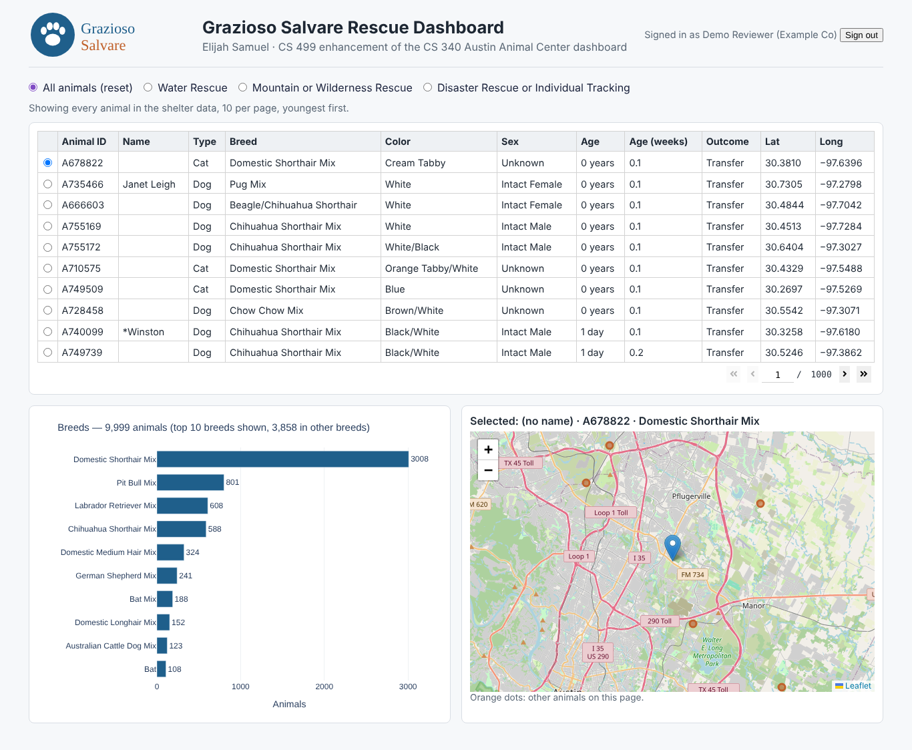
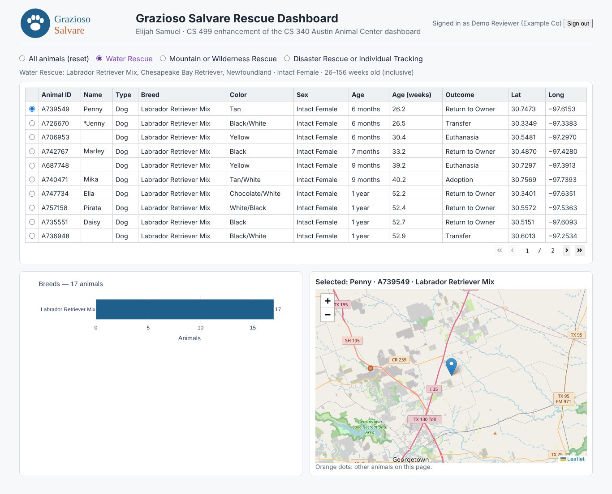
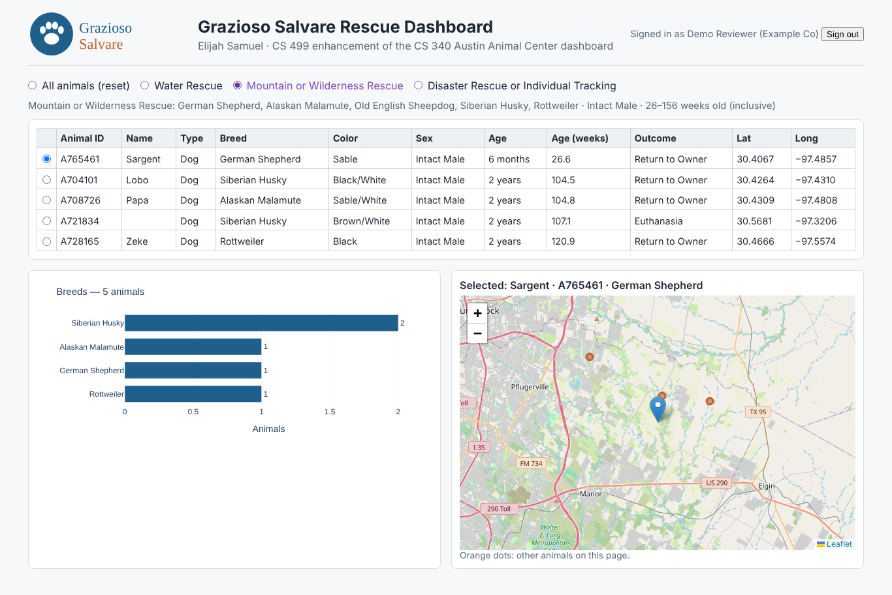
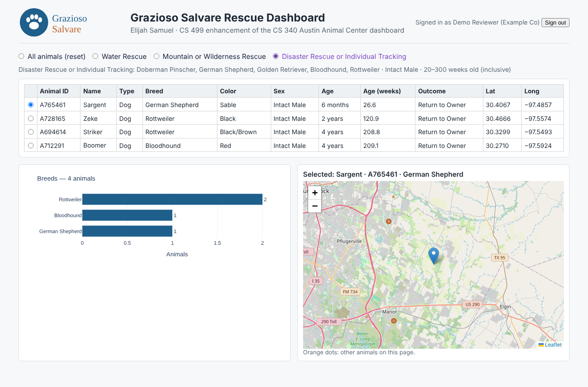
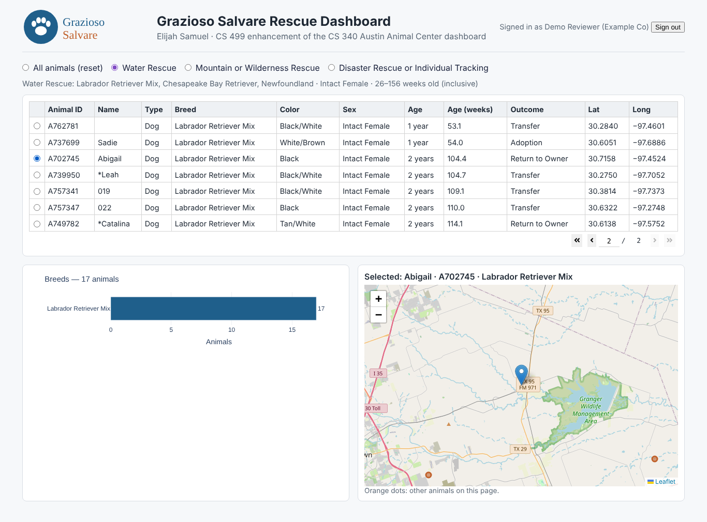
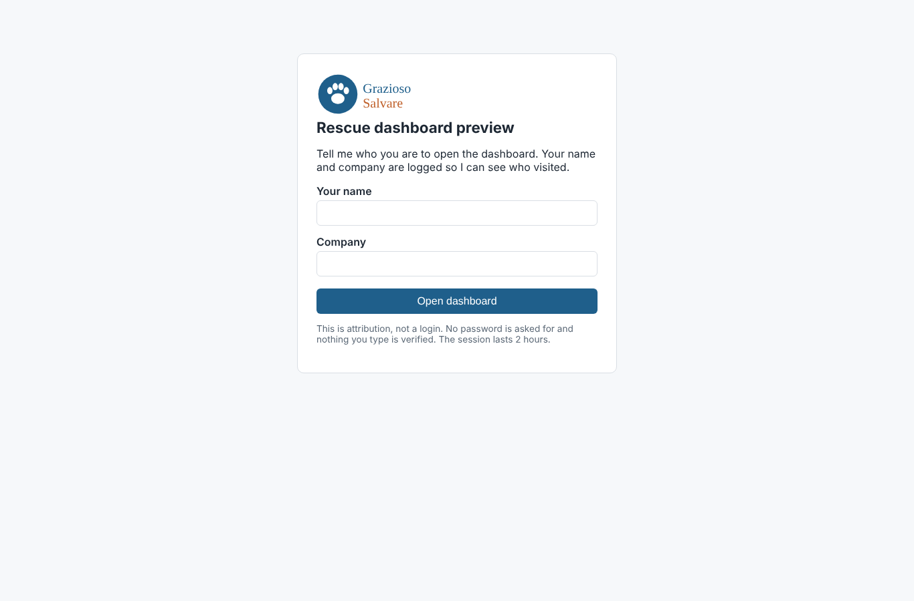

# Grazioso Salvare Animal Shelter Dashboard

A Python/MongoDB/Dash dashboard over Austin Animal Center outcome data. Pick a rescue type
(water, mountain/wilderness, disaster/tracking) and see the matching dogs as a paged table, a breed
chart, and a map.

It started as my SNHU CS 340 project (2025). This version is **Enhancement Three (Databases)** for
CS 499: the database layer was hardened and rebuilt around indexes, aggregation pipelines, schema
validation, and least-privilege access. The untouched CS 340 code is in [`original/`](original/).

## Before and after

| | CS 340 original | Enhanced |
|---|---|---|
| Runs as | Jupyter notebook (`jupyter_dash`) | Plain Dash app: `python app.py` |
| Connection | Hard-coded Apporto host; user/pass passed in | `MONGO_URI` from the environment; fails fast if missing; 5 s timeouts |
| DB account | Course account | Custom role: find/insert/update/remove on `aac.animals` only |
| Rescue filters | One breed per button; sex and age ignored | Full spec: breed list, preferred sex, age range in weeks |
| Query | `find()` returns every match to pandas; startup loads all 10,000 docs | `aggregate([$match, $sort, $skip, $limit, $project])`, one page at a time |
| Breed chart | Counted in pandas from the visible rows | `$group` pipeline in MongoDB over the whole result |
| Indexes | None (COLLSCAN, 9,999 docs examined) | ESR compound index + 2dsphere (IXSCAN, docs examined = docs returned) |
| Injection | `read(query)` passes any dict to `find()` | `$` keys rejected at any depth, field whitelist, plain values only |
| Mass writes | `delete({})` would wipe the collection | Empty filters refused on update/delete |
| Schema | None | `$jsonSchema` validator, `validationAction: "error"` |
| Errors | Raw `Exception(...)` and driver tracebacks | `ConfigurationError`, `ValidationError`, `DatabaseUnavailable`, `PermissionDenied` with safe messages |
| Known crashes | Broken import, missing logo file, map fails on an empty table | Fixed |
| Tests | None | 143 pytest tests (16 of them against a real `mongod --auth`) |

## Repo layout

| Path | What it is |
|---|---|
| `original/` | Byte-exact CS 340 `animal_shelter.py` and `dashboard.ipynb` (from git HEAD) |
| `shelter/` | The database layer: `config.py`, `animal_shelter.py`, `profiles.py`, `schema.py`, `errors.py`, `portal.py` |
| `app.py` | The Dash app (calls only `shelter/`) |
| `scripts/setup_db.py` | Validator, CSV import, indexes. Safe to rerun |
| `scripts/explain_report.py` | explain() before/after → `docs/explain/` |
| `scripts/injection_demo.py` | Shows injection filters rejected (output in `docs/injection_demo.txt`) |
| `scripts/create_local_users.py` | Creates the least-privilege users on a local `mongod --auth` |
| `scripts/visits_report.py` | Employer-portal engagement per company |
| `scripts/capture_screenshots.py` | Regenerates `docs/screenshots/` with headless Chromium |
| `tests/` | pytest suite |
| `data/` | The course CSV and where it came from ([`data/README.md`](data/README.md)) |
| `docs/` | Atlas steps, threat model, explain results, screenshots |
| `screenshots/` | The CS 340 screenshots from 2025 |

## Setup in 5 steps

1. **Python 3.11 or newer** (tested on 3.13). Create a virtual environment and install:
   `pip install -r requirements.txt` (add `-r requirements-dev.txt` for tests).
2. **MongoDB.** Either a free Atlas cluster — follow [`docs/ATLAS_SETUP.md`](docs/ATLAS_SETUP.md) —
   or a local `mongod --auth` plus `python scripts/create_local_users.py`.
3. **Config.** Copy `.env.example` to `.env` and fill in `MONGO_URI` (app user) and
   `MONGO_SETUP_URI` (setup user). `.env` is gitignored.
4. **Load data.** `python scripts/setup_db.py` — applies the validator, imports the CSV, builds the
   indexes. Expect `imported 9999 of 10000 rows; rejected 1` (see below).
5. **Run.** `python app.py` and open http://127.0.0.1:8050.

## Environment variables

| Variable | Needed by | Notes |
|---|---|---|
| `MONGO_URI` | app, demo scripts | Required. Least-privilege app user |
| `MONGO_DB`, `MONGO_COLLECTION` | all | Default `aac` / `animals` |
| `MONGO_TIMEOUT_MS` | all | Default 5000 |
| `MONGO_SETUP_URI` | `setup_db.py`, `explain_report.py` | User with `readWrite` + `dbAdmin` on `aac` |
| `MONGO_TEST_URI`, `MONGO_TEST_APP_URI`, `MONGO_TEST_DB` | integration tests | A separate test DB (default `aac_test`); tests refuse to run against `aac` |
| `DASH_HOST`, `DASH_PORT`, `DASH_DEBUG` | app | Debug is off unless `DASH_DEBUG=1` |
| `PORTAL_ENABLED`, `PORTAL_SECURE_COOKIE` | app | Employer portal (stretch), off by default |

## Running things

```bash
pytest                      # unit tests (mongomock); integration tests skip without MONGO_TEST_URI
pytest -m integration       # needs a real test database
python scripts/setup_db.py  # idempotent; --reload to re-import
python scripts/explain_report.py
python scripts/injection_demo.py
python app.py               # PORTAL_ENABLED=1 python app.py for the employer portal
```

Last full run (2026-10-11, Python 3.13, MongoDB 8.0.4 with `--auth`): **143 passed, 0 skipped**.

## Rescue profiles

The UI sends only a profile key. The criteria live on the server in `shelter/profiles.py`.

| Profile | Breeds | Sex | Age (weeks, inclusive) |
|---|---|---|---|
| Water Rescue | Labrador Retriever Mix, Chesapeake Bay Retriever, Newfoundland | Intact Female | 26–156 |
| Mountain or Wilderness Rescue | German Shepherd, Alaskan Malamute, Old English Sheepdog, Siberian Husky, Rottweiler | Intact Male | 26–156 |
| Disaster Rescue or Individual Tracking | Doberman Pinscher, German Shepherd, Golden Retriever, Bloodhound, Rottweiler | Intact Male | 20–300 |

These follow the Grazioso Salvare spec from CS 340 Project Two. I checked them against three
independent public implementations of the same assignment, which all agree.

## explain() results

Measured with `scripts/explain_report.py` on a local MongoDB 8.0.4, 9,999 documents. Full output
and raw JSON: [`docs/explain/SUMMARY.md`](docs/explain/SUMMARY.md).

| Query | Stage before → after | Docs examined before → after | Keys examined after | Returned | ms (median of 5) before → after |
|---|---|---|---|---|---|
| water | COLLSCAN → IXSCAN | 9,999 → 17 | 17 | 17 | 10 → 0 |
| mountain | COLLSCAN → IXSCAN | 9,999 → 5 | 5 | 5 | 5 → 0 |
| disaster | COLLSCAN → IXSCAN | 9,999 → 4 | 4 | 4 | 5 → 0 |
| geo (2 km `$geoWithin`) | COLLSCAN → IXSCAN | 9,999 → 67 | 90 | 55 | 12 → 0 |

Index cost: total index size went from 112 KB (`_id` only) to 636 KB — `profile_esr` 368 KB,
`location_2dsphere` 156 KB — against 5.0 MB of uncompressed data (1.4 MB on disk). Every insert
and update now maintains two more indexes. For a read-heavy dashboard that trade is worth it.

Why the compound index is `{sex_upon_outcome, breed, age_upon_outcome_in_weeks, _id}`: equality
fields first, then the sort/range field (the ESR rule). `_id` is last because paging sorts by
age then `_id` so pages never overlap; with `_id` in the index MongoDB merges the per-breed index
scans in order (`SORT_MERGE`) instead of sorting in memory.

## Screenshots

| | |
|---|---|
| All animals, page 1 |  |
| Water Rescue |  |
| Mountain or Wilderness Rescue |  |
| Disaster or Tracking |  |
| Page 2, third row selected, map follows |  |
| Employer portal sign-in |  |

Captured from the running app against the local auth-enabled database. Map tiles are
OpenStreetMap and need internet access.

## Data

`data/aac_shelter_outcomes.csv` is the CS 340 course file (10,000 rows with `location_lat` /
`location_long`). Source and terms are in [`data/README.md`](data/README.md). One row has a birth
date after its outcome date (age −7.04 weeks). The schema validator rejects it on import, so the
database holds 9,999 documents. The row is listed in `docs/import_report.json`.

## Employer portal (stretch)

Off by default. With `PORTAL_ENABLED=1` every route sits behind a sign-in form (name + company).
Sessions are stored server-side in MongoDB (hashed token, 2-hour expiry, TTL index); the cookie is
`HttpOnly`, `Secure`, `SameSite=Lax`; sign-in is rate-limited per IP; visits are logged and
summarized with a `$group` pipeline (`scripts/visits_report.py`). **The company name is
self-asserted — this is attribution, not authentication.** See
[`docs/THREAT_MODEL.md`](docs/THREAT_MODEL.md).

## Known limits

- `dash_table.DataTable` still works in Dash 4.4 but prints a deprecation notice; `dash-ag-grid` is
  the long-term replacement.
- The sign-in rate limit is in memory, per process.
- Atlas numbers are not in this README yet; the local numbers above come from the same scripts.
